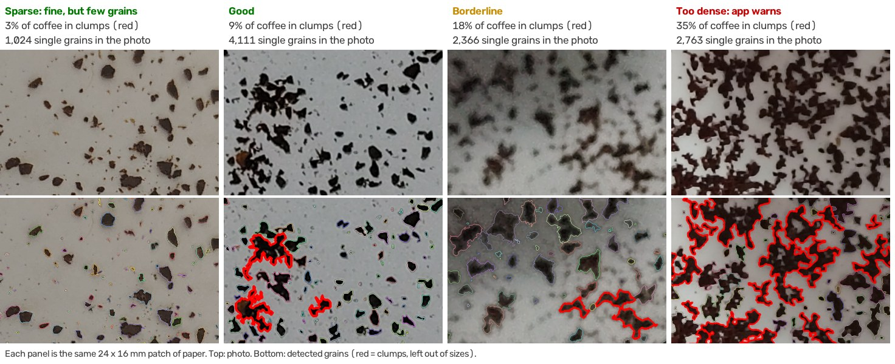
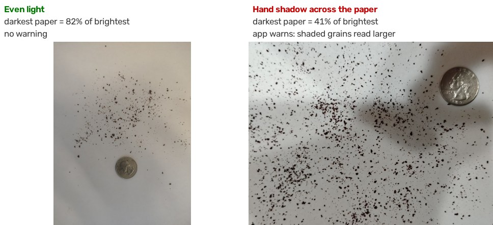

# TheDailyGrind

Measure your coffee grind from a phone photo. Spread a pinch of grounds on white paper next to a coin, take a photo, and get the grind size distribution (D10 / D50 / D90, fines, boulders) in seconds.

> **Status: early prototype.** Validated so far on one bean, one grinder and one phone (see [How well does it work?](#how-well-does-it-work)). Feedback is very welcome, especially [saved measurements](#saving-your-measurements) from other phones, grinders and brewers.

## Try it (about 5 minutes)

You need Python 3.10 or newer (tested on 3.12) and git.

```bash
git clone https://github.com/dgh-genomics/TheDailyGrind.git
cd TheDailyGrind
python3 -m venv .venv
source .venv/bin/activate          # Windows: .venv\Scripts\activate
pip install -r requirements.txt
streamlit run app.py
```

A browser tab opens. Drag in **`examples/sample_grounds.jpg`** to check everything works. You should see:

- *Calibrated: 0.0550 mm/px using US Quarter*, and no warnings
- about 4,100 particles, **D50 ≈ 1.07 ± 0.02 mm**, D10 ≈ 0.59 mm, D90 ≈ 1.82 mm
- a note that 9% of the coffee is in clumps (left out of the sizes)

Then try your own photos.

## Taking a photo the app can measure

How you spread and light the grounds matters more than anything else. In testing, spreading and lighting moved results by 5–15%, which is more than the difference between neighbouring grinder settings.

**Checklist**

1. **White paper**, plain and matte.
2. **A pinch of grounds, spread thin** so most grains have paper around them (see below). For more grains, take more photos rather than packing one.
3. **A coin** (US quarter by default; pick yours in the sidebar), fully in the frame, with a finger-width of clear paper around it.
4. **Even light over the whole sheet.** No hand or phone shadow across the paper.
5. **Main camera at 1× or 2×**, straight down. **No flash, no macro mode** (macro switches to the ultra-wide lens).
6. **JPEG at full resolution.** iPhone HEIC photos must be converted for the comparison script.

### How thin to spread

Each panel is the same 24 × 16 mm patch of paper (top: photo, bottom: what the app detects; red outlines are clumps).



- **Sparse** is accurate but has few grains per photo, so the ± is larger. Take a few photos.
- **Good**: most grains separate, under ~10% clumped.
- **Borderline** (~15–20%): still usable, but sizes are less reliable.
- **Too dense** (over 20%): the app warns. Clumps of touching grains can't be measured, so they're left out and the result rests on fewer grains.

### Light



The same grain measures about 6% larger where the paper is 10–30% darker, for example in your hand's shadow, than in direct light. The app warns when part of the paper is more than 30% darker than the rest. Light the whole sheet the same way: all in soft window light, or all under one lamp.

### What the warnings mean

| Warning | Cause | Fix |
|---|---|---|
| 📷 The flash fired / ultra-wide lens | Flash or macro mode (from the photo's EXIF data) | Main camera, flash off. These shots read 7–16% smaller |
| 🫘 X% of the coffee is in clumps | Grounds spread too densely | Spread thinner |
| 💡 Part of the paper is X% darker | A shadow or uneven light | Light the whole sheet evenly |
| Could not detect a circular reference object | Coin hidden, cut off, glaring or buried in grounds | Coin fully in frame, clear paper around it |

Photos sent through messaging apps usually lose their EXIF data, so the camera warning can't fire on them.

## Reading the results

- **D50**: half of the coffee is in grains smaller than this. The **±** is counting noise for this photo alone; differences between spreads and photos add to it.
- **Size weighting** (sidebar): *available mass* (default) counts the coffee water can reach (the outer 0.1 mm of each grain). Other options are *mass*, *surface* and *count*. Count is dominated by fines and depends on camera distance, so avoid it for comparisons.
- **Fines / Boulders**: share of the coffee in grains under half / over twice the D50.
- **Clumps**: touching grains that can't be separated (red in the *Detected Particles* tab). They're left out of the sizes. The caption also shows D50 *adjusted to no clumping*; that adjustment is provisional, measured on one bean.
- **The distribution chart** uses a log size axis, so the fine end is visible. Sizes the camera can't reliably detect at this distance (about 7 pixels across) are shaded grey.
- **Brew match**: a rough guide only; the size ranges behind it aren't calibrated.
- **CSV**: one row per measured grain (diameter, area, volume, weight).

Sizes are only comparable when photos are taken the same way (same phone and camera mode, similar spread and light).

## Comparing with a reference grind

D50 is a fair comparison only between distributions of the same *shape*. Two grinders can give the same D50 with very different amounts of fines, and fines are what tip a cup into astringency. So the app also records each grind's shape (its size quantiles relative to its own D50) and checks it before you compare.

Open **🔍 Compare with a saved measurement**, pick a saved reference (for example the grind that tastes right for a coffee), and the app shows:

- the D50 difference and the share of coffee in grains under 0.6 mm, side by side;
- a **shape check**, which says whether the two distributions can be compared on D50:

| Shape distance | Verdict | Seen in testing |
|---|---|---|
| ≤ 0.02 | **Same shape**: comparing D50 is like-for-like | repeat photos and separate spreads of one grind (all ≤ 0.018) |
| 0.02 – 0.03 | **Somewhat different**: compare D50 together with fines | other settings on the same grinder (median 0.019) |
| > 0.03 | **Clearly different**: D50 alone isn't fair; compare the full distributions and fines | another grinder, bean or photo setup (median 0.029), or a much coarser or finer grind |

**Shape also changes with size.** As a grinder is set coarser, its fine tail grows relative to its D50. On one grinder, a setting 25% coarser in D50 already scores 0.025. So when the D50s differ by more than 20%, the app says that part of the shape difference comes from the size gap alone. To compare two grinders, pick a reference of similar D50.

For example, against a reference ground on a KM5 grinder at setting 4.2, the same grinder at 3.8 read D50 −4% with the same shape (0.006). A Baratza Encore grind of a different coffee read D50 +54% and a clearly different shape (0.036). Against KM5 setting 5, closer in size, the same Encore grinds had the same shape (0.017–0.020). The cut-offs come from 22 photos and will be refined as more data comes in.

## Saving your measurements

Below the results, **📝 Save this measurement** adds one line to `measurements.jsonl`, in the folder you started the app from. Set the `TDG_MEASUREMENT_LOG` environment variable to use a different file. Each line records:

- **the measurement:** available-mass D10 / D50 / D90, clump-adjusted D50, fines, share of coffee under 0.6 mm, the distribution's shape signature, clumping, lighting evenness and grain count;
- **how the photo was taken:** phone make and model, lens, zoom and flash (from the photo's EXIF), and when it was taken;
- **what you enter:** bean / roast, grinder and setting, brew method, dose, water, taste, TDS and notes;
- **for traceability:** the app version, and a fingerprint of the photo so duplicates can be spotted.

It never stores the photo or its location (GPS). The file stays on your computer and is git-ignored.

**Helping test?** Your `measurements.jsonl`, with honest taste entries, is the most useful thing to send back. Across phones, grinders and brewers, these records are what will show how much each one matters.

## Comparing grinder settings

`compare_settings.py` measures many photos at once and tests whether the photos can tell grinder settings apart. Put photos in one folder per setting. Folder names are the setting numbers; optionally add one subfolder per separate grind:

```
photos/
  3/    grind_a/IMG_0001.jpg  grind_b/IMG_0007.jpg
  3.8/  ...
  4/    ...
```

```bash
python compare_settings.py photos/ --coin "US Quarter" --out results/
```

For each weighting it reports:

- each setting's mean D50 and photo-to-photo SD;
- the **separation** between neighbouring settings (ΔD50 ÷ photo-to-photo SD; aim for 3 or more, about 7% single-photo mix-ups);
- how many photos per measurement would reach that;
- leave-one-out accuracy.

A final block repeats the analysis with D50 adjusted to no clumping. The adjustment is estimated from your own photos when clumping varies enough.

It also checks each photo's **distribution shape**:

- **Within a setting:** a photo whose shape differs clearly from the other photos of its setting gets a warning. That usually means a spreading, lighting or camera problem.
- **Against a calibration grind:** with `--reference SETTING`, every photo and setting is compared with that grind's shape, using the same/somewhat/clearly-different verdicts as the app. For example, `--reference 4.2` makes your known-good grind the yardstick when you add photos from another grinder. Each setting's D50 difference from the reference is listed too; a `*` marks settings more than 20% apart in D50, where part of the shape difference comes from the size gap.

Output: `photos.csv` (one row per photo, including `clumped_pct`, `lighting_evenness_pct`, `span`, `gsd`, `skew`, the shape distances, `d50_vs_reference_pct` and `warnings`), per-grain CSVs, and `report.html`.

`gsd` (geometric SD) depends on how small a grain the camera can see, so compare it only between photos taken from the same distance. The shape distance hardly changes with distance (by 0.005 or less in testing).

Use **separate spreads** (fresh pinches) as replicates. Repeat photos of one spread contain the same grains, so they make settings look more separable than they are.

## How well does it work?

Measured so far (one bean, one grinder, one phone: Motorola edge 2024, 2× main camera):

- **Synthetic photos with known sizes:** D50 within 1–2% of the truth, at any spread density.
- **Same spread, photographed again:** D50 agrees within about 3% in even light. Lit grains match to 3–5% each.
- **Dose response, settings 3 to 5** (8 separate spreads, two sessions): D50 rises steadily with setting.
  - After clump handling, a straight line fits with R² 0.97.
  - One spread predicts the setting to within about ±0.2 of a step (±0.16 to ±0.25, depending on whether the provisional clump adjustment is counted).
- **Taste:** for this bean, a 0.4-step change crossed into over-extraction. One photo can't resolve that reliably yet; several spreads per measurement can.
- **A second grinder (first look):** a Baratza Encore at settings 15 and 19 (a different coffee) read D50 1.6–1.7 mm. That matches the KM5 at about 6.5–6.8, extrapolated from the setting 3–5 line. Compared with KM5 5, the closest in size, the Encore had the same shape. So far, the two grinders differ mainly in coarseness, not in distribution shape.

**Not yet known or not yet handled:**

- **Other phones:** they may differ by more than the effects above.
- **Absolute accuracy:** never checked against a sieve or laser diffraction.
- **Coin fit:** some fits land on the coin's raised inner rim, reading 1–4% small.
- **Shadows:** biased sizes are warned about, not corrected.
- **Fines:** grains under about 0.3 mm aren't reliably detected at normal distances.

## How it works

1. **Coin calibration**:
   - Hough circle candidates, retried on a shadow-corrected copy if none is found.
   - Each candidate's edge is measured along 360 rays and fitted with an ellipse, so a tilted phone still gives the right average scale.
2. **Paper normalization**: the blue channel, where coffee contrasts most with white paper, is divided by a smooth estimate of the local paper brightness.
3. **Threshold** at 58.8% of paper brightness, about halfway between coffee and paper, so blurred edges are neither grown nor shrunk.
4. **Watershed** splits touching grains, but only where the neck between them is narrower than half the smaller grain's width.
5. **Edge rejection** drops grains cut off by the photo edge or the coin.
6. **Clumps** (particles much less solid than a single grain) are flagged and left out of the sizes.
7. **Measurement**:
   - diameter of a circle with the same area;
   - volume as an ellipsoid whose hidden axis equals its short axis;
   - available mass, assuming water reaches 0.1 mm into each grain.
8. **Checks**: camera from EXIF, clumping, and lighting evenness.

Optional MobileSAM refinement of larger grains (`pip install -r requirements-sam.txt`, adds PyTorch) exists for comparison. It read grains too large in testing, so it's off by default.

## Inspired by

- [coffeegrindsize](https://github.com/jgagneastro/coffeegrindsize) by Jonathan Gagné: the original image-based coffee grind analyzer. The blue-channel threshold, edge rejection, ellipsoid volumes and available-mass weighting come from it.
- [coffeegrindsize v1.0.0](https://github.com/csatt/coffeegrindsize/releases/tag/v1.0.0) by csatt: a refined fork with improved usability.

## License

MIT
